<div align="center">


# FarmLens

**A crop-health node you can build: a Raspberry Pi camera node, optional ESP32 sensors and a phone app that finds it on your hotspot.**

[](https://github.com/AbdelRahman-Madboly/farmlens/actions/workflows/ci.yml)
[](https://github.com/AbdelRahman-Madboly/farmlens/releases/latest)


[Download the app](https://github.com/AbdelRahman-Madboly/farmlens/releases/latest/download/farmlens.apk) · [Quick start](#quick-start) · [Setup guide](docs/SETUP-GUIDE.md) · [Hardware](#hardware) · [Status](#status) · [Roadmap](#roadmap)

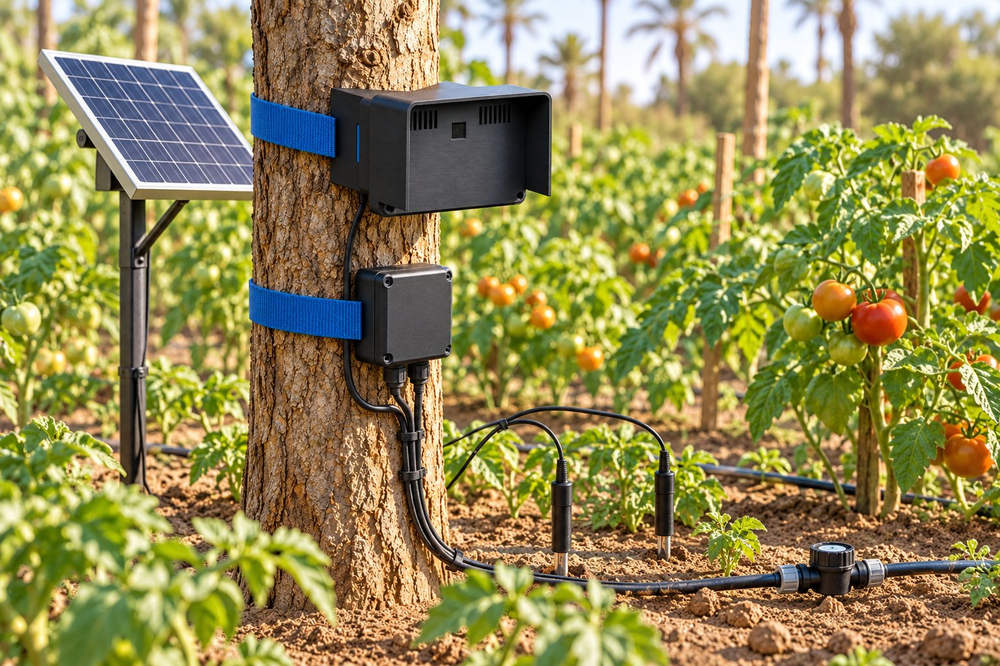

<sub>Concept image of the planned field setup, not a photo of a built unit.</sub>

</div>

## Why FarmLens

A grower needs to know when a crop is stressed or diseased before it shows from across the field.
FarmLens combines a camera image score with soil-moisture and water-level readings into one risk
score, on a small node that runs in the field and reports to a phone, with no cloud account and
no router.

## Highlights

- **One command on the Pi.** `install.sh` installs or updates the node, finds the camera, joins
  the phone hotspot and starts the node on every boot.
- **No addresses to type.** The app scans the phone's Wi-Fi and hotspot for the node and finds it
  again when its address changes.
- **Live camera.** An MJPEG stream from the Pi to the app and to a web dashboard on the node.
- **Fusion score.** Visual score and soil stress combined into one score with weights and an alert
  threshold you can change from the app.
- **Printable case.** A PETG case with a rain hood and a tree saddle: STL, STEP, parametric source
  and a sliced plate.

## How it works

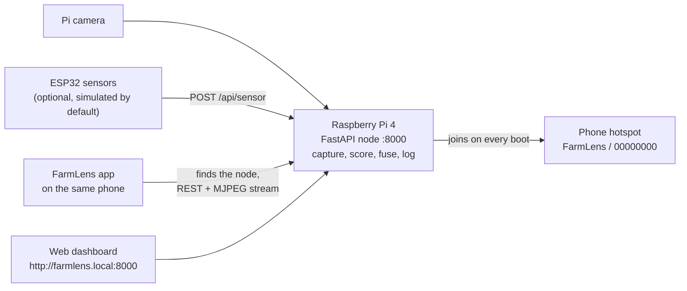

Every 30 seconds the node captures a frame, scores it, fuses the score with the latest sensor
reading, saves the cycle to SQLite with its image, and serves the result to the app and the web
dashboard.

```
Cs        = 0.6 * moisture_stress + 0.4 * water_stress
Ccombined = w1 * Cv + w2 * Cs        (defaults w1 = 0.6, w2 = 0.4)
Alert     = Ccombined > theta         (default theta = 0.5)
```

`Cv` is the visual disease score in [0, 1]. The weights and threshold are starting values for the
prototype, not tuned against data. Data flow and the API are in
[docs/ARCHITECTURE.md](docs/ARCHITECTURE.md).

## Quick start

The full walk-through, with Raspberry Pi Imager settings, camera wiring and screenshots, is in
**[docs/SETUP-GUIDE.md](docs/SETUP-GUIDE.md)**. The short version:

**1. Phone hotspot.** Set the Android phone's hotspot to exactly:

| Setting | Value |
|---|---|
| Hotspot name (SSID) | `FarmLens` (capital F and L) |
| Password | `00000000` (eight zeros) |
| Security | WPA2-Personal (or "WPA2/WPA3"), not WPA3-only |
| Band | 2.4 GHz |

> **Note:** this name and password are public. Turn the hotspot off after a demo, or use your own
> with `--ssid "<name>" --password "<password>"` after `bash -s --` in step 3.

**2. Raspberry Pi on normal Wi-Fi.** Raspberry Pi OS Bookworm or newer (64-bit), connected to
any Wi-Fi with internet (home or office), so it can download the packages. Connect the camera
ribbon with the Pi off, then power on.

**3. Install the node.** Open a terminal on the Pi (screen and keyboard, or SSH from a laptop on
the same Wi-Fi), paste this line and press Enter:

```bash
curl -fsSL https://raw.githubusercontent.com/AbdelRahman-Madboly/farmlens/main/install.sh | bash
```

It creates `~/farmlens`, downloads the project, installs everything, finds the camera, saves the
`FarmLens` hotspot and makes the node start on every boot. The Pi stays on the normal Wi-Fi while
it installs. It takes five to ten minutes and ends with "FarmLens node is running".

If the short line fails, the full one is
`curl -fsSL https://raw.githubusercontent.com/AbdelRahman-Madboly/farmlens/main/node/rpi/bootstrap.sh | bash`, or with git:
`git clone https://github.com/AbdelRahman-Madboly/farmlens.git ~/farmlens && ~/farmlens/node/rpi/setup.sh`.

**4. Switch to the hotspot.** Turn on the phone hotspot (`FarmLens` / `00000000`), then on the
Pi run `sudo reboot`. After about a minute the phone's hotspot screen lists `farmlens` as a
connected device. If the Pi ever starts on the normal Wi-Fi first, it moves to the hotspot by
itself within about 30 seconds of the hotspot coming on.

**5. Install the app.** On the phone, open
[farmlens.apk](https://github.com/AbdelRahman-Madboly/farmlens/releases/latest/download/farmlens.apk),
download it, open it and allow installing from this source. All versions are on the
[releases page](https://github.com/AbdelRahman-Madboly/farmlens/releases).

**6. Open FarmLens.** It finds the node by itself. If it shows the Connect screen, tap **Find my
node**. The **Camera** tab shows the live stream.

### Every demo after that

1. Turn on the phone hotspot (`FarmLens` / `00000000`).
2. Power on the Pi and wait about a minute.
3. Open the FarmLens app.

### Update

Run the command from step 3 again (the Pi needs internet: normal Wi-Fi, or the hotspot with
mobile data), or `~/farmlens/node/rpi/setup.sh` on the Pi. It pulls the
latest code, keeps settings and history, and restarts the node. An older install (the old
`install.sh` or `~/farmlens-rpi`) is taken over and its settings are copied. For a new app
version, download the APK again.

### If something does not work

Run the health check on the Pi, `~/farmlens/node/rpi/status.sh`: it shows the service, the
camera, the Wi-Fi and the last log lines. The most common fixes:

| Problem | What to do |
|---|---|
| `curl: (22) ... error: 404` | The URL was mistyped. Copy the line exactly; the full path is `.../farmlens/main/node/rpi/bootstrap.sh` (note `node/`) |
| The Pi never joins the hotspot | Name exactly `FarmLens`, password `00000000`, 2.4 GHz, WPA2. Turn the hotspot off and on |
| The app says "No node found" | Wait a minute after power on, tap **Find my node** again. Fallback: type the Pi's IP (from the hotspot's connected devices list) and port `8000` |
| "Simulated frames" in the Camera tab | The node found no camera when it started. Run `rpicam-hello --list-cameras` on the Pi: if it says "No cameras available", power off, reseat the ribbon (contacts facing the HDMI ports on a Pi 4, fully pushed in at both ends), power on. The node looks for the camera at every start. `status.sh` shows the reason |

More in the [setup guide's troubleshooting](docs/SETUP-GUIDE.md#8-troubleshooting).

### Run it on a computer (no hardware)

Needs Python 3.11+ and, for the app, Flutter 3.x.

```bash
cd node/rpi
python3 -m venv .venv && . .venv/bin/activate
pip install -r requirements-dev.txt
python main.py                    # serves http://127.0.0.1:8000
```

Open `http://127.0.0.1:8000` for the web dashboard. To use the app, run the node with
`API_HOST=0.0.0.0` so a phone or emulator on the same network can reach it, then
`cd app && flutter pub get && flutter run`. An Android emulator reaches the host machine at
`10.0.2.2`.

## Using the app

| Connect | Dashboard | Camera | Log |
|---|---|---|---|
| 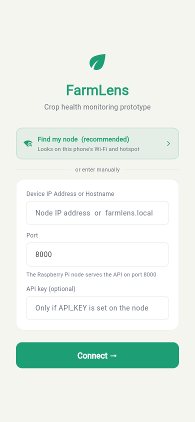 | 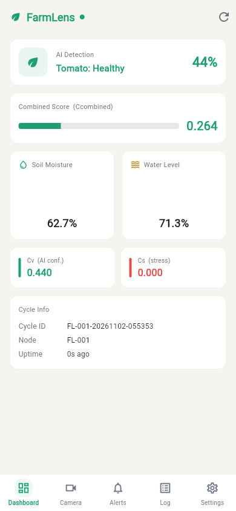 | 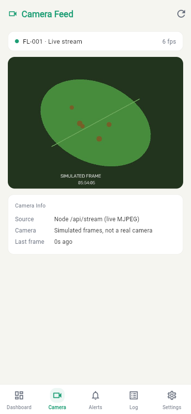 | 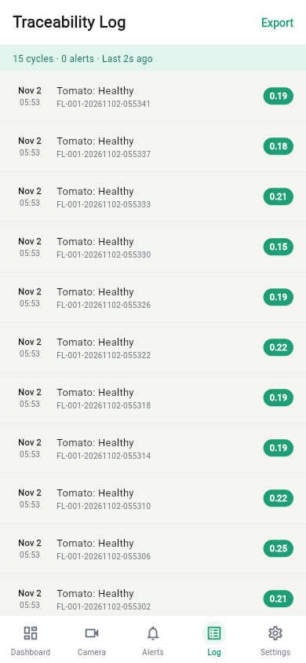 |

<sub>Screenshots with the node in simulated mode (no camera attached).</sub>

| Screen | What to do there |
|---|---|
| Dashboard | The combined risk score, the moisture and water cards and the latest label. An alert banner appears when the score passes the alert threshold |
| Camera | The live stream from the Pi camera with its frame rate. It reconnects by itself after a drop |
| Alerts | Every cycle that passed the threshold while the app was open |
| Log | One row per 30 s cycle. Pull down to refresh, tap a row to see that cycle's image and numbers, export the list as JSON |
| Settings | Move the two weight sliders and the threshold, pick the crop, test the connection. Saving writes the values to the node |
| Connect | Opens when no node is found: **Find my node** scans again, or type the address and port `8000` |

The node also serves a web dashboard at `http://farmlens.local:8000`:

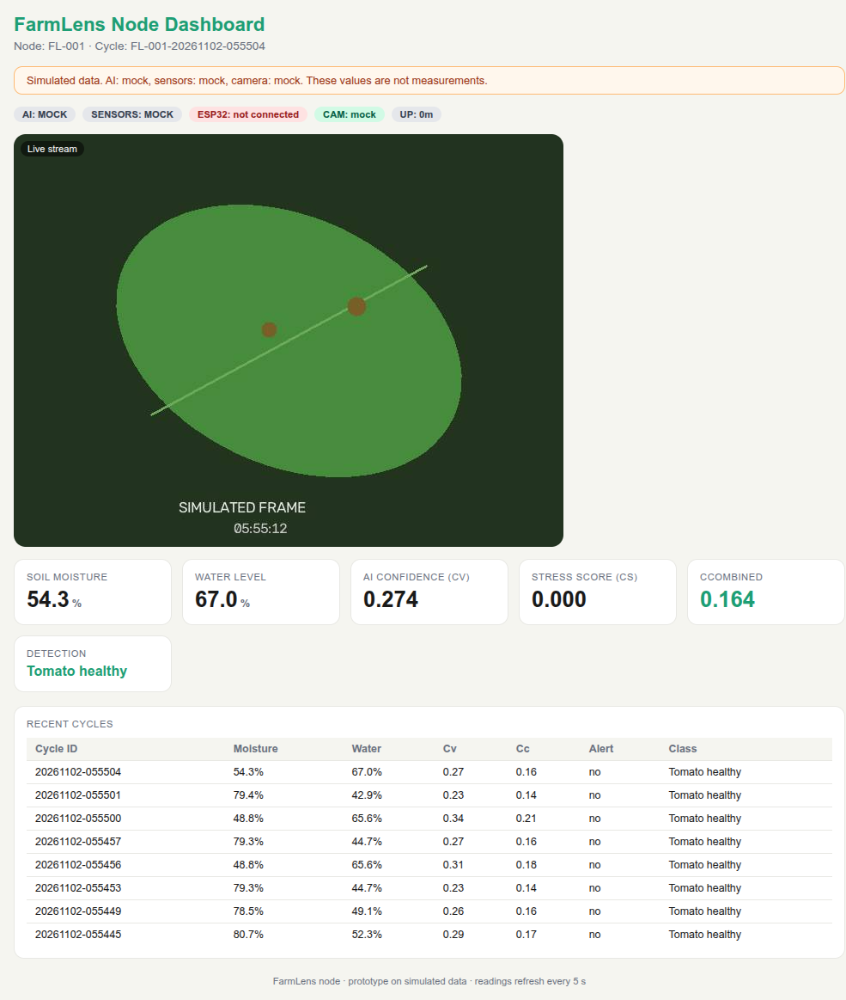

## Hardware

| Front | Side | Back |
|---|---|---|
| 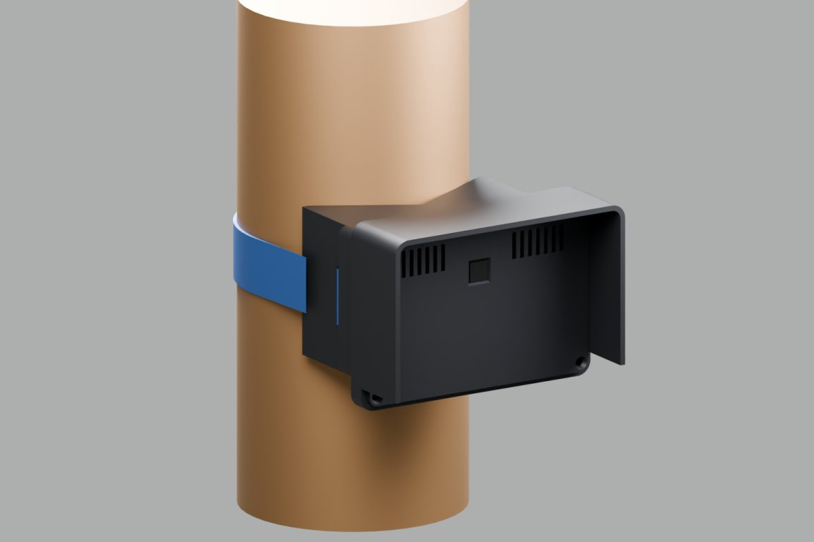 | 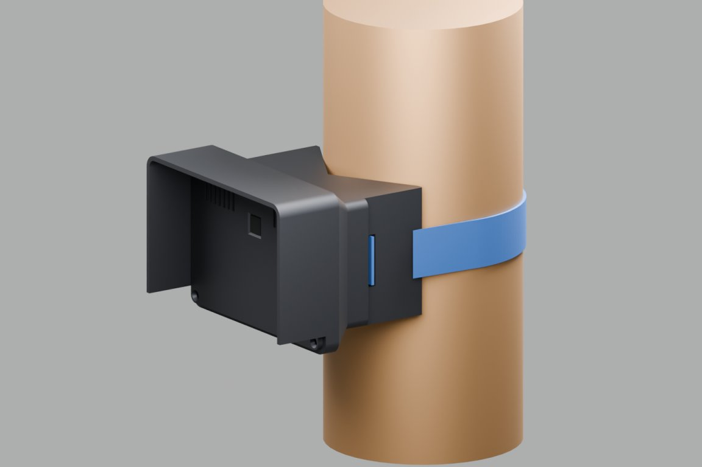 | 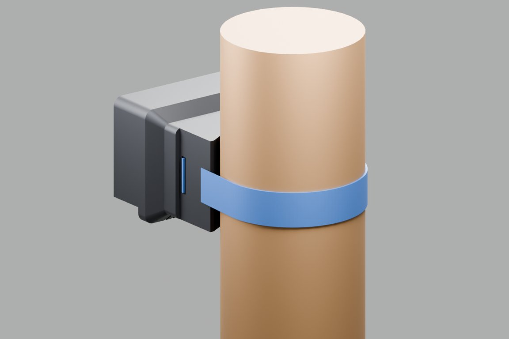 |

| Part | Used | Notes |
|---|---|---|
| Computer | Raspberry Pi 4 Model B | Runs the FastAPI node, camera capture and the web dashboard |
| Camera | Raspberry Pi camera module v1.3, or a USB webcam | picamera2 or OpenCV, picked by `setup.sh` |
| Power | 5 V 3 A USB-C supply or power bank | A weak supply makes the Pi drop Wi-Fi |
| Sensor board | ESP32 (`esp32dev`), optional | Sends moisture and water readings to `POST /api/sensor`; simulated readings by default |
| Case | 3D-printed PETG case with rain hood and a tree saddle | See below |

The case files are in [`hardware/pi-cam-case`](hardware/pi-cam-case):

| Files | For |
|---|---|
| [`stl/`](hardware/pi-cam-case/stl) base, lid, saddle | Printing in any slicer (oriented for printing) |
| [`print/`](hardware/pi-cam-case/print) sliced 3MF | Printing directly on a Bambu Lab A1 in PETG, nut pauses included |
| [`cad/step/`](hardware/pi-cam-case/cad/step) base, lid, saddle, assembly | Opening or editing in FreeCAD, Fusion, Onshape or SolidWorks |
| [`cad/source/`](hardware/pi-cam-case/cad/source) | Parametric source (Python, build123d): change `dimensions.yaml`, run `build.py` |

Screws, print settings and assembly steps are in the
[case README](hardware/pi-cam-case/README.md).

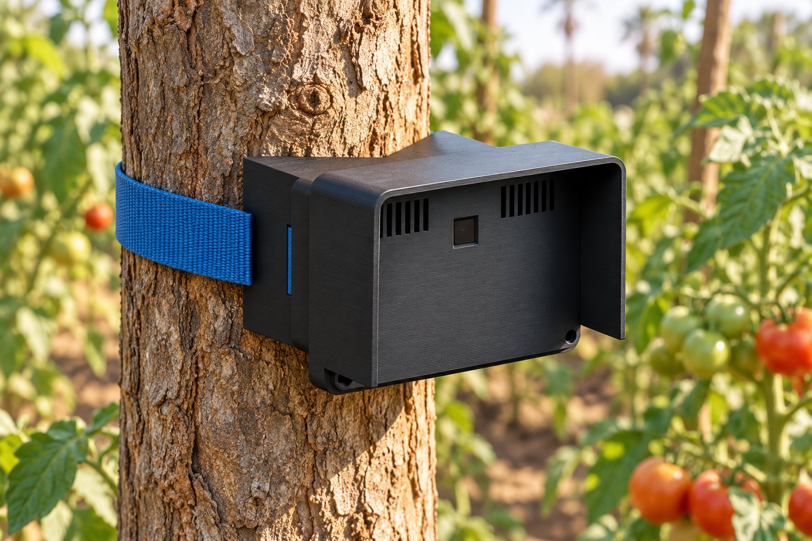

<sub>Concept image, not a photo of a built unit.</sub>

## Status

**Prototype / MVP on simulated data.** There is no trained model, no dataset and no field
measurement. The camera can be real (Pi camera module or USB webcam); sensor readings and the
disease score still come from simulators in this repository.

| Area | Working now | Not built yet |
|---|---|---|
| Pi server (`node/rpi`) | FastAPI server, 30 s capture-infer-fuse-log cycle, SQLite history, JPEG per cycle, live MJPEG stream, web dashboard, REST API used by the app. `setup.sh` installs or updates it, joins a phone hotspot and starts it on boot | `setup.sh` has not yet been run on a physical Pi for this release |
| Sensors | `mock_sensor.py` generates moving moisture and water readings in-process (`SENSOR_MODE=mock`); `POST /api/sensor` accepts readings from the ESP32 | No probes wired or calibrated |
| Inference | Mock mode (random-walk score, default). TFLite classifier path with fallback to mock when no model or runtime is present | No trained model is shipped. The TFLite path is tested only with a dummy, untrained model generated for the tests |
| Camera | Mock backend (synthetic, labelled frames); picamera2 and OpenCV backends. `setup.sh` picks the one it finds | Not yet tested against a physical camera |
| Firmware (`node/firmware`) | Compiles for ESP32 (`esp32dev`); posts simulated readings over WiFi; optional analog-probe build | Not flashed or run on a board for this release |
| App (`app`) | Finds the node on the phone's Wi-Fi or hotspot, live dashboard, alerts, cycle log with images, live camera stream, fusion settings, optional API key. APK on the releases page | Not in any store; not yet tested on a physical phone |
| Case (`hardware/pi-cam-case`) | STL, STEP, parametric source, sliced A1 plate | Not field-tested |
| Security | Optional API key on write endpoints | No TLS, no user accounts. LAN-only prototype, see [SECURITY.md](SECURITY.md) |

## Roadmap

- [ ] Run `setup.sh` and the live stream on a physical Pi and camera
- [ ] Test the app on a physical phone
- [ ] Wire and calibrate the soil-moisture and water-level probes
- [ ] Flash and run the ESP32 firmware on a board
- [ ] Train and ship a disease classifier for the TFLite path
- [ ] Field-test the case
- [ ] TLS and user accounts
- [ ] Multi-node platform, see [docs/roadmap.md](docs/roadmap.md)

## Tests

Each command is what CI runs (`.github/workflows/ci.yml`).

| Part | Command | Result at v0.2.0 |
|---|---|---|
| Pi server | `cd node/rpi && pytest` | 59 passed |
| Firmware logic | `cd node/firmware && pio test -e native` | 7 passed |
| Firmware build | `cd node/firmware && pio run -e esp32dev` | builds |
| App | `cd app && flutter analyze && flutter test` | no issues, 62 passed |

## Repository layout

| Path | What it is |
|---|---|
| `install.sh` | Short install command for the Pi; runs `node/rpi/bootstrap.sh` |
| `node/rpi/` | Python/FastAPI server for the Raspberry Pi, with tests. `bootstrap.sh` and `setup.sh` install and update it, `status.sh` checks it |
| `node/firmware/` | ESP32 firmware (PlatformIO), with host-side unit tests |
| `app/` | Flutter companion app, with unit and widget tests |
| `hardware/pi-cam-case/` | Case for the Pi and camera: STL, STEP, parametric CAD source, sliced plate, pictures, part list |
| `docs/SETUP-GUIDE.md` | Step-by-step setup for a new user: SD card, Pi, app, troubleshooting |
| `docs/ARCHITECTURE.md` | Data flow, fusion formula, API contract |
| `docs/roadmap.md` | Future work, including the multi-node platform |

## Release the app

Push a version tag and GitHub builds the APK and attaches it to a release:

```bash
git tag v0.2.0 && git push origin v0.2.0
```

`.github/workflows/release-apk.yml` runs the tests, builds `farmlens.apk`, and publishes it. The
download link at the top of this file always points to the newest release. The APK is signed with
a build-time debug key, so a phone may need the old version uninstalled before a new one installs.

## Security

See [SECURITY.md](SECURITY.md) for what is protected, what is not, and how to report a problem.

## License

MIT, see [LICENSE](LICENSE).

## Author

Designed and built by **Abdel Rahman Mohamad EL-Sayed** ([@AbdelRahman-Madboly](https://github.com/AbdelRahman-Madboly)) as a [VINEX](https://github.com/VINEX-Tech) product.
