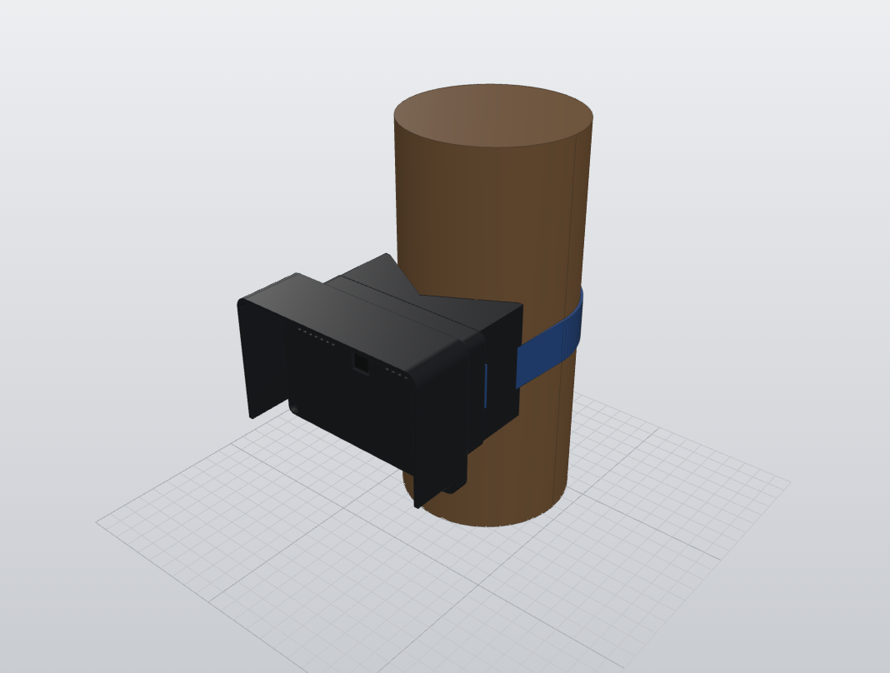
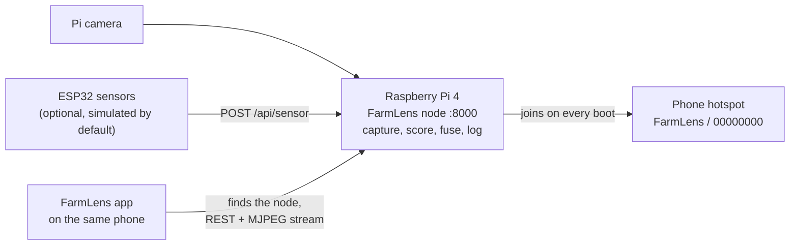

# FarmLens


Crop-health node prototype: a Raspberry Pi server that combines a camera
image score with soil-moisture and water-level readings into one risk score,
an ESP32 firmware that sends sensor readings to it, and a Flutter app that
shows the result.

**Status: prototype / MVP on simulated data.** There is no trained model, no
dataset and no field measurement. The camera can be real (Pi camera module or
USB webcam); sensor readings and the disease score still come from
simulators in this repository.

| | |
|---|---|
| **Android app** | [Download farmlens.apk](https://github.com/AbdelRahman-Madboly/farmlens/releases/latest/download/farmlens.apk) (all versions on the [releases page](https://github.com/AbdelRahman-Madboly/farmlens/releases)) |
| **Raspberry Pi** | One command installs or updates the node: see [Quick start](#quick-start) |
| **Step-by-step guide** | [docs/SETUP-GUIDE.md](docs/SETUP-GUIDE.md): from a blank SD card to the live camera on your phone |
| **Case, CAD and STL** | [hardware/pi-cam-case](hardware/pi-cam-case): STL, STEP, parametric source and a ready-to-print plate |

| Case design | In the field | Close up |
|---|---|---|
|  |  |  |

The first picture is the 3D design. The other two are concept images of the planned field setup,
not photos of a built unit.

## The app

| Connect | Dashboard | Camera | Log |
|---|---|---|---|
|  |  |  |  |

Screenshots with the node in simulated mode (no camera attached). The node also serves a web
dashboard at `http://farmlens.local:8000`:


## How it works



The Pi joins the phone's hotspot, and the app on that phone finds it and shows the readings and
the live camera. No router, no laptop, no IP addresses to type.

## Quick start

The full walk-through, with Raspberry Pi Imager settings, camera wiring and screenshots, is in
**[docs/SETUP-GUIDE.md](docs/SETUP-GUIDE.md)**. The short version:

**1. Phone hotspot.** Set the Android phone's hotspot to exactly:

| Setting | Value |
|---|---|
| Hotspot name (SSID) | `FarmLens` (capital F and L) |
| Password | `00000000` (eight zeros) |
| Security | WPA2-Personal (or "WPA2/WPA3"), not WPA3-only |
| Band | 2.4 GHz |

> **Note:** this name and password are public. Turn the hotspot off after a demo, or use your own
> with `--ssid "<name>" --password "<password>"` in step 3.

**2. Raspberry Pi OS.** Raspberry Pi OS Bookworm or newer (64-bit). On a new SD card, set
hostname `farmlens`, SSH on, and Wi-Fi `FarmLens` / `00000000` in Raspberry Pi Imager's OS
customisation, so the Pi joins the hotspot on its first boot. Connect the camera ribbon with the
Pi off, then power on.

**3. Install the node.** Open a terminal on the Pi (`ssh pi@farmlens.local` from a laptop on the
same hotspot, or a screen and keyboard), paste this line and press Enter:

```bash
curl -fsSL https://raw.githubusercontent.com/AbdelRahman-Madboly/farmlens/main/node/rpi/bootstrap.sh | bash
```

It downloads the project to `~/farmlens`, installs everything, finds the camera, saves the
`FarmLens` hotspot and makes the node start on every boot. It takes five to ten minutes and ends
with "FarmLens node is running". Then `sudo reboot`.

The same with git: `git clone https://github.com/AbdelRahman-Madboly/farmlens.git ~/farmlens &&
~/farmlens/node/rpi/setup.sh`.

**4. Install the app.** On the phone, open
[farmlens.apk](https://github.com/AbdelRahman-Madboly/farmlens/releases/latest/download/farmlens.apk),
download it, open it and allow installing from this source.

**5. Open FarmLens.** It finds the node by itself. If it shows the Connect screen, tap **Find my
node**. The **Camera** tab shows the live stream.

### Every demo after that

1. Turn on the phone hotspot (`FarmLens` / `00000000`).
2. Power on the Pi and wait about a minute.
3. Open the FarmLens app.

### Update

Run the command from step 3 again, or `~/farmlens/node/rpi/setup.sh` on the Pi. It pulls the
latest code, keeps settings and history, and restarts the node. An older install (the old
`install.sh` or `~/farmlens-rpi`) is taken over and its settings are copied. For a new app
version, download the APK again.

### If something does not work

Run the health check on the Pi, `~/farmlens/node/rpi/status.sh`: it shows the service, the
camera, the Wi-Fi and the last log lines. The most common fixes:

| Problem | What to do |
|---|---|
| The Pi never joins the hotspot | Name exactly `FarmLens`, password `00000000`, 2.4 GHz, WPA2. Turn the hotspot off and on |
| The app says "No node found" | Wait a minute after power on, tap **Find my node** again. Fallback: type the Pi's IP (from the hotspot's connected devices list) and port `8000` |
| "Simulated frames" in the Camera tab | No camera found: power off, reseat the ribbon cable, then run `~/farmlens/node/rpi/setup.sh --no-apt` |

More in the [setup guide's troubleshooting](docs/SETUP-GUIDE.md#8-troubleshooting).

### Using the app

| Screen | What to do there |
|---|---|
| Dashboard | The combined risk score, the moisture and water cards and the latest label. An alert banner appears when the score passes the alert threshold |
| Camera | The live stream from the Pi camera with its frame rate. It reconnects by itself after a drop |
| Alerts | Every cycle that passed the threshold while the app was open |
| Log | One row per 30 s cycle. Pull down to refresh, tap a row to see that cycle's image and numbers, export the list as JSON |
| Settings | Move the two weight sliders and the threshold, pick the crop, test the connection. Saving writes the values to the node |
| Connect | Opens when no node is found: **Find my node** scans again, or type the address and port `8000` |

## Working now vs not built yet

| Area | Working now | Not built yet |
|---|---|---|
| Pi server (`node/rpi`) | FastAPI server, 30 s capture-infer-fuse-log cycle, SQLite history, JPEG per cycle, live MJPEG stream, web dashboard, REST API used by the app. `setup.sh` installs or updates it, joins a phone hotspot and starts it on boot | `setup.sh` has not yet been run on a physical Pi for this release |
| Sensors | `mock_sensor.py` generates moving moisture and water readings in-process (`SENSOR_MODE=mock`); `POST /api/sensor` accepts readings from the ESP32 | No probes wired or calibrated |
| Inference | Mock mode (random-walk score, default). TFLite classifier path with fallback to mock when no model or runtime is present | No trained model is shipped. The TFLite path is tested only with a dummy, untrained model generated for the tests |
| Camera | Mock backend (synthetic, labelled frames); picamera2 and OpenCV backends. `setup.sh` picks the one it finds | Not yet tested against a physical camera |
| Firmware (`node/firmware`) | Compiles for ESP32 (`esp32dev`); posts simulated readings over WiFi; optional analog-probe build | Not flashed or run on a board for this release |
| App (`app`) | Finds the node on the phone's Wi-Fi or hotspot, live dashboard, alerts, cycle log with images, live camera stream, fusion settings, optional API key. APK on the releases page | Not in any store; not yet tested on a physical phone |
| Security | Optional API key on write endpoints | No TLS, no user accounts. LAN-only prototype, see [SECURITY.md](SECURITY.md) |
| Multi-node platform | - | Future work, see [docs/roadmap.md](docs/roadmap.md) |

## Run the demo on a computer (no hardware)

Needs Python 3.11+ and, for the app, Flutter 3.x.

```bash
cd node/rpi
python3 -m venv .venv && . .venv/bin/activate
pip install -r requirements-dev.txt
python main.py                    # serves http://127.0.0.1:8000
```

Open `http://127.0.0.1:8000` for the web dashboard. It shows a banner while
any part of the data is simulated. Sensor values move every few seconds and a
new cycle is logged every 30 seconds (`CYCLE_INTERVAL_S` to change it).

To use the app, run the node with `API_HOST=0.0.0.0` so a phone or emulator on
the same network can reach it, then:

```bash
cd app
flutter pub get
flutter run
```

Enter the computer's LAN address and port `8000` on the Connect screen. An
Android emulator reaches the host machine at `10.0.2.2`.

## Hardware

| Front | Side | Back |
|---|---|---|
|  |  |  |

| Part | Used | Notes |
|---|---|---|
| Computer | Raspberry Pi 4 Model B | Runs the FastAPI node, camera capture and the web dashboard |
| Camera | Raspberry Pi camera module v1.3, or a USB webcam | picamera2 or OpenCV, picked by `setup.sh` |
| Power | 5 V 3 A USB-C supply or power bank | A weak supply makes the Pi drop Wi-Fi |
| Sensor board | ESP32 (`esp32dev`), optional | Sends moisture and water readings to `POST /api/sensor`; simulated readings by default |
| Case | 3D-printed PETG case with rain hood and a tree saddle | See below |

The case files are in [`hardware/pi-cam-case`](hardware/pi-cam-case):

| Files | For |
|---|---|
| [`stl/`](hardware/pi-cam-case/stl) base, lid, saddle | Printing in any slicer (oriented for printing) |
| [`print/`](hardware/pi-cam-case/print) sliced 3MF | Printing directly on a Bambu Lab A1 in PETG, nut pauses included |
| [`cad/step/`](hardware/pi-cam-case/cad/step) base, lid, saddle, assembly | Opening or editing in FreeCAD, Fusion, Onshape or SolidWorks |
| [`cad/source/`](hardware/pi-cam-case/cad/source) | Parametric source (Python, build123d): change `dimensions.yaml`, run `build.py` |

Screws, print settings and assembly steps are in the
[case README](hardware/pi-cam-case/README.md).

## Repository layout

| Path | What it is |
|---|---|
| `node/rpi/` | Python/FastAPI server for the Raspberry Pi, with tests. `bootstrap.sh` and `setup.sh` install and update it, `status.sh` checks it |
| `node/firmware/` | ESP32 firmware (PlatformIO), with host-side unit tests |
| `app/` | Flutter companion app, with unit and widget tests |
| `hardware/pi-cam-case/` | Case for the Pi and camera: STL, STEP, parametric CAD source, sliced plate, pictures, part list |
| `docs/SETUP-GUIDE.md` | Step-by-step setup for a new user: SD card, Pi, app, troubleshooting |
| `docs/ARCHITECTURE.md` | Data flow, fusion formula, API contract |
| `docs/roadmap.md` | Future work, including the multi-node platform |

## Fusion formula

```
Cs        = 0.6 * moisture_stress + 0.4 * water_stress
Ccombined = w1 * Cv + w2 * Cs        (defaults w1 = 0.6, w2 = 0.4)
Alert     = Ccombined > theta         (default theta = 0.5)
```

`Cv` is the visual disease score in [0, 1]. The weights and threshold are
starting values for the prototype, not tuned against data.

## Tests

| Part | Command | Result at v0.2.0 |
|---|---|---|
| Pi server | `cd node/rpi && pytest` | 59 passed |
| Firmware logic | `cd node/firmware && pio test -e native` | 7 passed |
| Firmware build | `cd node/firmware && pio run -e esp32dev` | builds |
| App | `cd app && flutter analyze && flutter test` | no issues, 62 passed |

CI runs all of these on every push, see `.github/workflows/ci.yml`.

## Release the app

Push a version tag and GitHub builds the APK and attaches it to a release:

```bash
git tag v0.2.0 && git push origin v0.2.0
```

`.github/workflows/release-apk.yml` runs the tests, builds
`farmlens.apk`, and publishes it. The download link at the top of this file
always points to the newest release. The APK is signed with a build-time debug
key, so a phone may need the old version uninstalled before a new one installs.

## Licence

MIT, see [LICENSE](LICENSE). Credit: VINEX.

## Author

Designed and built by Abdel Rahman Mohamad EL-Sayed ([AbdelRahman-Madboly](https://github.com/AbdelRahman-Madboly) on GitHub) as a VINEX product.
