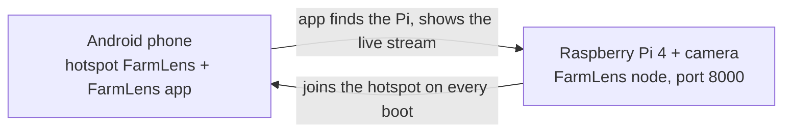
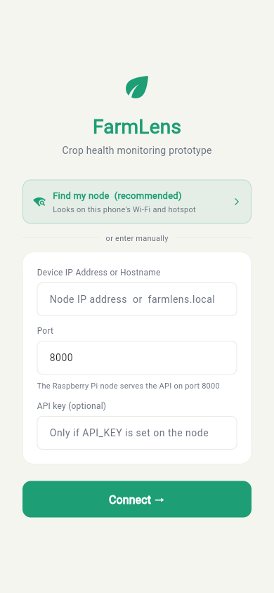
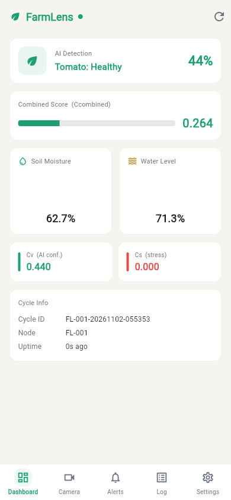
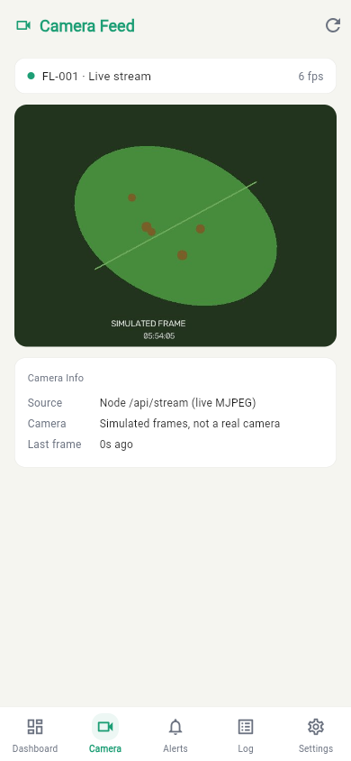
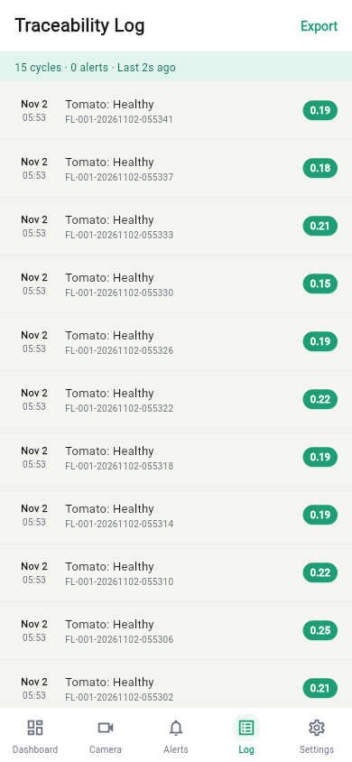
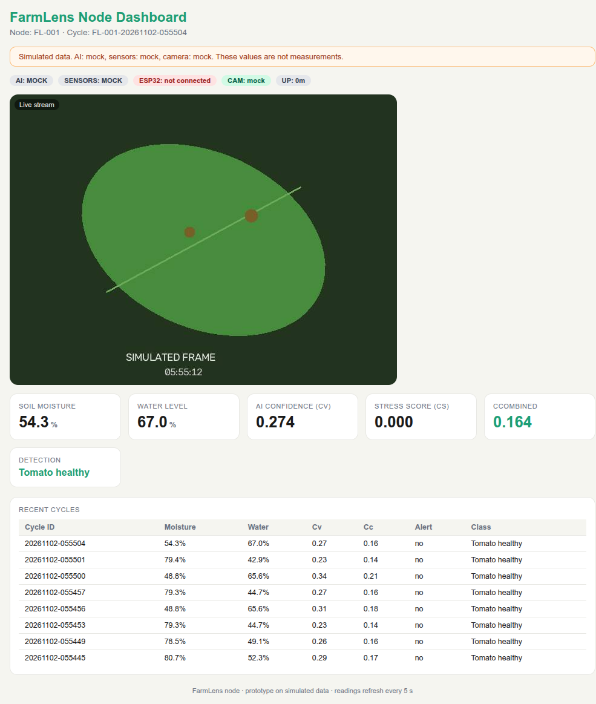

# FarmLens setup guide

From a blank SD card to the live camera on your phone. About 30 minutes the
first time, most of it waiting for downloads. After that, every demo is: phone
hotspot on, Pi power on, open the app.



- [1. What you need](#1-what-you-need)
- [2. Prepare the SD card](#2-prepare-the-sd-card)
- [3. Connect the camera and power on](#3-connect-the-camera-and-power-on)
- [4. Install the FarmLens node on the Pi](#4-install-the-farmlens-node-on-the-pi)
- [5. Install the app and connect](#5-install-the-app-and-connect)
- [6. Every demo after that](#6-every-demo-after-that)
- [7. Update](#7-update)
- [8. Troubleshooting](#8-troubleshooting)

## 1. What you need

| Item | Notes |
|---|---|
| Raspberry Pi 4 Model B | Pi 3 B+, Pi 5 and Zero 2 W should also work; the case fits the Pi 4 only |
| microSD card, 16 GB or more | With an SD card reader for the computer |
| Pi camera module (v1.3, v2 or v3) with its ribbon cable, or a USB webcam | Without a camera the node still runs and shows simulated frames |
| 5 V 3 A USB-C power supply, or a power bank that gives 3 A | A weak supply makes the Pi reboot or drop Wi-Fi |
| Android phone | Runs the hotspot and the app |
| A computer, once | To write the SD card. Also handy for SSH, but not required |
| Printed case (optional) | Files and screws in [`hardware/pi-cam-case`](../hardware/pi-cam-case) |

## 2. Prepare the SD card

The goal is to start the Pi already joined to the phone hotspot, with SSH on,
so you never need a screen or keyboard for it.

1. Set the **phone hotspot** first (Settings, Hotspot and tethering):

   | Setting | Value |
   |---|---|
   | Hotspot name | `FarmLens` (capital F and L) |
   | Password | `00000000` (eight zeros) |
   | Security | WPA2-Personal, or "WPA2/WPA3". Not WPA3-only |
   | Band | 2.4 GHz |

   > The name and password are public. Turn the hotspot off after a demo.

2. On the computer, install **Raspberry Pi Imager** from
   <https://www.raspberrypi.com/software/> and open it.
3. Choose **Raspberry Pi 4** as the device, **Raspberry Pi OS (64-bit)** (or
   **Raspberry Pi OS Lite (64-bit)**) as the operating system, and the SD card
   as the storage.
4. When Imager offers **OS customisation**, choose **Edit settings** and set:

   | Setting | Value |
   |---|---|
   | Hostname | `farmlens` |
   | Username and password | Any, for example `pi` and a password you will remember |
   | Configure wireless LAN | SSID `FarmLens`, password `00000000`, Wireless LAN country `EG` (or yours) |
   | Locale | Your time zone and keyboard |
   | Services tab | Enable SSH, "Use password authentication" |

5. Write the card. It takes a few minutes.

If the Pi already has Raspberry Pi OS Bookworm or newer, skip this section:
the setup script in step 4 adds the hotspot itself.

## 3. Connect the camera and power on

1. With the Pi **off**, lift the black latch of the camera connector (the
   long slot between the HDMI ports and the audio jack on a Pi 4).
2. Push the ribbon cable in fully, silver contacts facing the HDMI ports, and
   press the latch down. Do the same on the camera board if the cable came
   loose there.
3. Put the SD card in the Pi. Turn on the phone hotspot (with mobile data on:
   the Pi downloads packages through it). Plug in the power.
4. Wait two to three minutes on the first boot. The phone's hotspot screen
   then lists a connected device called `farmlens`. Tap it to see its IP
   address if you need it.

## 4. Install the FarmLens node on the Pi

Open a terminal on the Pi, by any of these routes:

| Route | How |
|---|---|
| Laptop joined to the same `FarmLens` hotspot | `ssh pi@farmlens.local` (Windows, macOS and Linux all have `ssh`). If the name does not resolve, use the IP from the phone's connected devices list: `ssh pi@192.168.x.x` |
| The phone itself | An SSH app such as Termux (`pkg install openssh`, then `ssh pi@<IP>`), using the IP from the connected devices list |
| Screen and keyboard on the Pi | Log in on the Pi directly |

Replace `pi` with the username you chose. Then paste this line and press Enter:

```bash
curl -fsSL https://raw.githubusercontent.com/AbdelRahman-Madboly/farmlens/main/node/rpi/bootstrap.sh | bash
```

It takes five to ten minutes. It:

- downloads the project to `~/farmlens`
- installs the packages and the camera libraries
- finds the camera and writes the settings (`node/rpi/.env`)
- names the Pi `farmlens` and saves the `FarmLens` hotspot with top priority,
  so the Pi joins it on every boot
- installs the `farmlens` service, which starts the node on every boot

It ends with **FarmLens node is running** and the addresses to use. Then:

```bash
sudo reboot
```

Rebooting once makes sure the camera permissions and hostname are applied.

## 5. Install the app and connect

1. On the phone, open
   <https://github.com/AbdelRahman-Madboly/farmlens/releases/latest/download/farmlens.apk>,
   download it and open the file. Android asks to allow installing apps from
   the browser or file manager: allow it, then tap **Install**.
2. Open **FarmLens**. It looks for the node on the hotspot and opens the
   dashboard. If it shows the Connect screen, tap **Find my node**.
3. Open the **Camera** tab for the live stream.

| Connect | Dashboard | Camera | Log |
|---|---|---|---|
|  |  |  |  |

The screenshots show the node in simulated mode (no camera attached), so the
frame is labelled SIMULATED FRAME.

The node also serves a web dashboard. On the phone or the laptop, open
`http://farmlens.local:8000` (or `http://<Pi IP>:8000`):



## 6. Every demo after that

1. Turn on the phone hotspot (`FarmLens` / `00000000`).
2. Power on the Pi. Wait about a minute.
3. Open the FarmLens app.

Nothing else. The node starts by itself, joins the hotspot, and the app finds
it even when its address changed.

## 7. Update

Run the setup command from step 4 again, or on the Pi:

```bash
~/farmlens/node/rpi/setup.sh
```

It pulls the latest code, keeps your settings and history, and restarts the
node. For a new app version, download the APK again from the same link. If
Android refuses to install over the old one, uninstall FarmLens first.

An install from before this script (the old `install.sh` or a copy in
`~/farmlens-rpi`) is taken over: its `.env` and history are copied, and the
old folder is left for you to delete.

## 8. Troubleshooting

Start with the health check on the Pi. It shows the service, the camera, the
Wi-Fi and the last log lines in one screen:

```bash
~/farmlens/node/rpi/status.sh
```

| Problem | What to do |
|---|---|
| `farmlens` never appears in the hotspot's connected devices | Check the hotspot is exactly `FarmLens` / `00000000`, 2.4 GHz, WPA2. Turn the hotspot off and on. If you used Imager, check the Wi-Fi country was set. With a screen on the Pi, `nmcli device wifi list` shows what it can see |
| The app says "No node found" | Wait a minute after power on and tap **Find my node** again. The phone running the app must be the one sharing the hotspot (or on the same Wi-Fi as the Pi). Fallback: type the Pi's IP from the connected devices list on the Connect screen, port `8000` |
| `ssh pi@farmlens.local` does not resolve | Use the IP from the hotspot's connected devices list. Before setup has run, the name is whatever you set in Imager (`raspberrypi` by default) |
| The camera shows "Simulated frames" | No camera was found. Power off, reseat the ribbon cable at both ends (contacts the right way round), power on, then run `~/farmlens/node/rpi/setup.sh --no-apt` |
| The stream is slow or stutters | Move the phone closer. Set `STREAM_FPS=5` or `STREAM_QUALITY=50` in `~/farmlens/node/rpi/.env`, then `sudo systemctl restart farmlens` |
| The Pi reboots or drops off Wi-Fi | Use a 5 V 3 A supply. Check with `vcgencmd get_throttled` (anything other than `0x0` means under-voltage or heat) |
| Use a different hotspot | `~/farmlens/node/rpi/setup.sh --no-apt --ssid "<name>" --password "<password>"` |
| Anything else | `journalctl -u farmlens -n 50` shows the node's log; `sudo systemctl restart farmlens` restarts it. Send the output of `status.sh` to whoever helps you |

Setup options, configuration variables and the API are described in
[`node/rpi/README.md`](../node/rpi/README.md).
