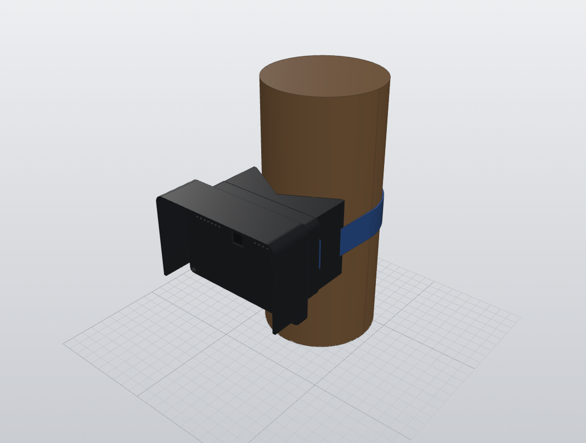

# FarmLens Pi camera case

Outdoor case for the FarmLens node: a Raspberry Pi 4 Model B and a Pi camera (v1.3) in a PETG
shell with a rain hood, mounted on a tree trunk or pole with a strap. Part of the FarmLens
monorepo; see the [root README](../../README.md).

The trunk and strap in the picture are for scale only.

## Status

Design prototype (assembly version v004). Print files are oriented for printing.

## Printed parts

| File | Part | Material |
|---|---|---|
| `stl/base.stl` | Case base with rain hood, Pi on standoffs | PETG |
| `stl/lid.stl` | Front lid holding the camera | PETG |
| `stl/saddle.stl` | V saddle for trunks or rods 50 to 150 mm across, with tunnels for one 25 mm strap | PETG |

## Hardware

| Item | Use |
|---|---|
| M1.6 x 5 self-tapping screws | Pi and camera to their posts |
| M3 x 12 countersunk screws + M3 nuts | Lid to base; nuts dropped into pockets at a print pause |
| M3 x 10 countersunk screws + M3 nuts | Saddle to base, screwed from inside the case |
| 25 mm strap | Saddle to trunk |

## Design notes

- Anything fixed to the back stays inside the back face's outline, so no upward face holds rain.
- Each nut bears on the part it clamps, with a 3 mm web between the nut and the case.
